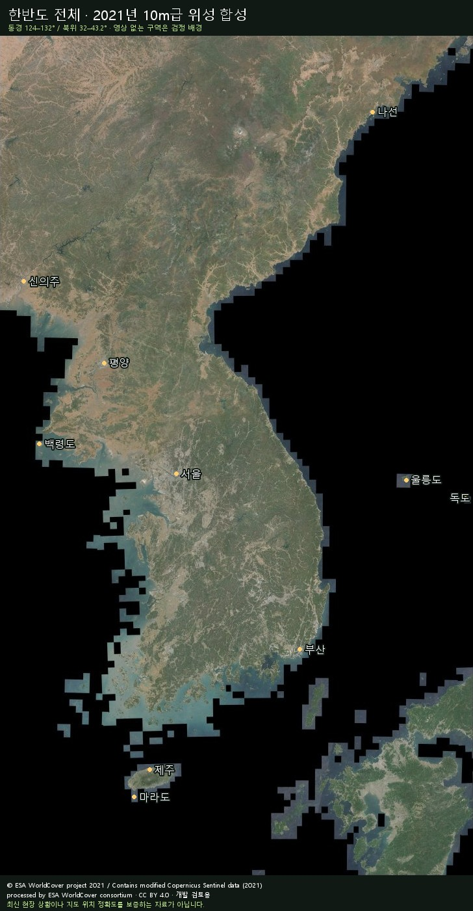

# Tac_Nav

인터넷 권한 없이 실행하는 Galaxy / Android용 WGS84 · MGRS 좌표/지도 앱입니다. **한반도 전체 경량 2D 지도를 APK에 기본 포함**합니다. 설치 후 지도 파일을 따로 준비할 필요가 없습니다. 실제 위성영상은 선택 반입하며, 현재는 **현장 검증 전 개발 버전**입니다.

## 기능

- MapLibre Native(OpenGL ES)가 로컬 PMTiles 위성지도와 경량 2D 벡터 지도를 직접 읽습니다. 서버, 계정, API 키, WebView가 없습니다.
- 지도 상단 실시간 현위치 MGRS와 GPS 갱신 중단 표시, 좌표 탭 현위치 WGS84.
- 상단 ⌖ 버튼으로 지도 중심 좌표·저장 패널 표시/숨김, 작은 ⓘ 버튼과 설정에서 지도 출처·라이선스 확인.
- 지도 중심 좌표, NGA MGRS 격자, 좌표변환(십진도/도분/도분초), MGRS 셀 중심과 경계 표시.
- GNSS 정확도·수신 경과시간, 진북/자북/도북 방위, 도/6400밀, NOAA WMM2025 자기편각.
- 지점 저장·이름 수정·삭제, 직선거리·방위, 수동 경유선.
- 앱 화면을 보고 있을 때만 수동 이동기록, GPS 수신 공백별 구간 분리, 강제 종료 후 중단 상태 표시. 홈 이동·다른 앱 전환·화면 꺼짐 시 GPS·방향 센서·지도 렌더링을 중지하고 기록을 저장 후 종료합니다. 백그라운드 서비스와 알림 권한을 사용하지 않습니다.
- 지점·이동궤적 GeoJSON 반입/반출. 반입 궤적은 원본 시간·정확도를 보존하지 않으며 화면에 이를 표시합니다.
- **설정**: 좌표 형식, MGRS 정밀도, 도/밀, 북쪽 기준, 시스템/주간/야간, 격자, 지도 화면 켜짐, 기록 간격(1/5/10/30초), 지도팩 관리. DataStore에 영구 저장하며 기록 중 간격 변경도 적용합니다.
- INTERNET 권한 제거, 앱 전용 내부 저장, 백업·기기 이전 제외, FLAG_SECURE. 별도 DB 암호화는 없습니다. 반출 파일은 평문입니다.

지도 SDK 초기화에 필요한 `ACCESS_NETWORK_STATE`는 연결 상태 조회용 권한입니다. 인터넷 송수신 권한인 `INTERNET`은 최종 APK에서 제거되어 있습니다.

## 개발과 빌드

소스에서 빌드할 때는 Python 3.12 이상으로 기본 지도 데이터를 먼저 준비합니다. 대용량 원본은 Git 이력에 넣지 않고 개발 배포 파일에서 받아 SHA-256을 검증합니다. 휴대폰 사용자는 완성된 APK만 설치하면 됩니다.

```powershell
python tools/setup_builtin_map.py
# 이미 지도팩이 있다면: python tools/setup_builtin_map.py samples/Korean_Peninsula_OSM_2026_2D.tacmap
```

기본 지도는 APK의 압축하지 않은 PMTiles 자산을 직접 읽습니다. 첫 실행 시 지도 반입이나 내부 저장소 사본 생성이 없으며, 앱을 다시 열어도 지도를 복사하지 않습니다.

Android Studio에서 이 폴더를 엽니다. JDK 17, Android SDK 35, Build Tools 35.0.0, NDK 27.0.12077973, CMake 3.22.1이 필요합니다. `local.properties`에 본인의 `sdk.dir`를 설정합니다. 도구와 의존성을 처음 받는 개발 PC에는 인터넷이 필요하며, 앱 운용 시에는 필요하지 않습니다.

```powershell
.\gradlew.bat :app:assembleDebug :app:testDebugUnitTest :app:lintDebug
python -m pip install -r tools/requirements-map.txt
python -m unittest discover -s tools -p "test_*.py" -v
```

디버그 APK: `app/build/outputs/apk/debug/app-debug.apk`. Android 10 이상, arm64-v8a / x86_64를 지원합니다. 배포용 서명키는 저장소에 포함하지 않습니다. 정식 배포 시 Android Studio의 Generate Signed Bundle / APK로 조직 소유 키를 사용하고 업데이트에도 동일한 키를 유지해야 합니다.

단말 연결 후:

```powershell
adb install -r app/build/outputs/apk/debug/app-debug.apk
.\gradlew.bat :app:connectedDebugAndroidTest
```

위치 권한은 **정확한 위치**를 허용하세요. 앱 화면이 보일 때만 GPS·나침반·기록이 작동합니다. 홈 이동, 다른 앱 전환, 화면 꺼짐 시 기록을 저장 후 종료하고 GPS·방향 센서를 해제합니다. 다시 열면 GPS는 재개하지만 이동기록은 직접 시작해야 합니다. Galaxy 실기기의 배터리·발열은 별도 측정이 필요합니다.

## 휴대폰 설치와 한반도 전체 지도

| 파일 | 용량 | 사용 |
|---|---:|---|
| APK | 약 372.4 MB | 한반도 기본 2D 포함, 이것만 설치해도 사용 가능 |
| 위성 `.tacmap` | 약 1.78 GB | 위성영상이 필요할 때만 추가 반입 |


[GitHub 개발 배포 페이지](https://github.com/kjsu1994/tac_nav/releases/tag/v0.1.0-dev)에서 **APK만 받아 설치하면 한반도 전체 2D 지도를 바로 사용할 수 있습니다.** 2D 지도 파일을 별도로 휴대폰에 설치하지 않습니다.

1. Galaxy에 APK를 복사하고 ‘내 파일’에서 실행해 설치합니다. Android 10 이상이 필요합니다.
2. 앱을 열면 **한반도 기본 2D** 지도가 자동으로 선택됩니다. 현위치 표시에는 정확한 위치 권한을 허용합니다.
3. 위성영상도 필요할 때만 `Korean_Peninsula_ESA_2021_10m.tacmap`을 휴대폰에 복사하고 **설정 → .tacmap 반입**에서 추가합니다.
4. 설정의 지도 목록에서 기본 2D와 위성지도를 전환합니다. 기본 2D 지도는 삭제되지 않으며 별도 지도팩을 삭제하면 기본 지도로 돌아갑니다.

기본 2D 지도 데이터는 약 297MB이며 APK 용량에 포함됩니다. 설치 후 지도 데이터를 다시 내려받거나 내부 저장소에 중복 복사하지 않습니다. 서버·계정·API 키·앱 인터넷 권한이 필요하지 않습니다.

기본 2D와 위성 팩의 공통 범위는 **동경 124~132도, 북위 32~43.2도**로 남북한 본토, 제주·마라도·백령도·울릉도·독도를 포함합니다. ESA WorldCover의 **2021년 Sentinel-2 연간 RGB 합성영상, 원본 약 10m급**입니다. 한 날짜의 촬영 영상이 아니며 최신 상황을 나타내지 않습니다. 영상이 없는 바다 등의 구역은 배경으로 표시됩니다. 경계 사각형에는 주변국 일부도 들어갑니다.

대용량 지도 원본은 소스 Git 이력에 넣지 않고 개발 배포 파일로 제공합니다. GitHub 파일 크기 제한으로 분할 배포한 경우 함께 제공된 병합 스크립트로 **PC에서 하나의 `.tacmap`으로 합친 뒤** 휴대폰으로 복사합니다. 추가 위성지도 등을 반입할 때는 다운로드한 지도팩과 앱 내부 사본이 공존하므로 지도 크기의 2배 이상 여유 공간을 확보합니다. 반입 성공 후 Download의 원본은 삭제해도 됩니다.

`samples/Seoul_Sentinel2_2025-11-12.tacmap`은 기존 서울 약 20km 범위의 3MB 개발·회귀시험용 자료입니다. **전체 운용 범위의 기본 지도는 한반도 팩**입니다. 각 팩과 같은 이름의 JSON에 실제 원본·촬영기간·범위가 기록됩니다.

### 경량 2D 지도

`Korean_Peninsula_OSM_2026_2D.tacmap`은 같은 한반도 전체 범위의 **296,503,412바이트(약 297MB / 283MiB)** 지도입니다. 2026-11-09 OSM 자료를 사용한 Protomaps v4 벡터 지도이며 도로·지명·수계·녹지·일부 건물을 표시합니다. 위성사진, 등고선, 고도, 자동 길찾기 자료는 포함하지 않습니다. 최대 원본 확대 단계는 13이며 그 이상은 같은 자료를 확대하므로 세부 정보가 추가되지 않습니다. 북한 등 OSM 자료가 적은 지역은 도로·지명이 누락될 수 있습니다.

이 2D 데이터는 APK에 기본 포함됩니다. 배포 페이지의 별도 `.tacmap`은 소스 빌드·재제작용이며 휴대폰 사용에는 필요하지 않습니다. 위성 팩을 추가로 가져오면 설정 목록에서 전환할 수 있습니다. 지도팩을 지워도 사용자 지점·궤적은 별도로 보존됩니다. 한글·한자·가나와 라틴·키릴 문자의 Noto SDF 글리프를 APK에 포함하며 지도 글꼴을 서버에서 받지 않습니다. 지도 표시 중 인터넷 연결은 필요하지 않습니다. 파일 크기는 작지만 배터리 절감 비율은 실기기에서 측정해야 합니다.

재제작에는 [공식 PMTiles CLI](https://docs.protomaps.com/pmtiles/cli)가 필요합니다. 공개 빌드 보존기간 때문에 날짜는 [사용 가능한 빌드](https://maps.protomaps.com/builds/)로 바꿉니다. 캐시는 같은 원본·범위의 파일만 사용하세요.

```powershell
python tools/build_lite_map.py samples/Korean_Peninsula_OSM_2026_2D.tacmap --pmtiles pmtiles --date 2026-11-09
```

출처·규격: [Protomaps 공개 지도](https://docs.protomaps.com/basemaps/downloads), [v4 레이어](https://docs.protomaps.com/basemaps/layers), [OpenStreetMap 저작권/ODbL](https://www.openstreetmap.org/copyright). Noto 글꼴은 SIL OFL 1.1이며 라이선스 본문을 APK에 포함합니다.



### 전체 지도 재제작

Python 3.12 이상이 설치된 인터넷 연결 PC에서 실행합니다. 완성한 원본 타일과 변환이 끝난 행은 캐시에 보존되므로 중단 후 같은 명령으로 이어서 처리할 수 있습니다. 변환 구간은 SQLite 트랜잭션으로 저장하고 재개 시 무결성을 검사합니다. 지도팩 출력 파일이 이미 있으면 덮어쓰지 않습니다. 캐시 디렉터리를 다른 연도·범위의 데이터와 섞지 마세요.

```powershell
python -m pip install -r tools/requirements-map.txt
python tools/build_korea_map.py samples/Korean_Peninsula_ESA_2021_10m.tacmap --cache .map-cache --workers 4
python -m unittest discover -s tools -p "test_*.py" -v
```

원본 공개 COG 76개는 총 약 30GiB입니다. 원본은 타일별로 내려받아 RGB로 변환한 뒤 원본 파일을 지우며, 캐시·중간 파일·최종 팩을 위해 PC 저장공간은 20GiB 이상 필요합니다. 다운로드 속도와 CPU에 따라 제작 시간이 길어질 수 있습니다. 이 인터넷 연결은 **PC에서 지도를 제작할 때만** 필요합니다.

공식 원본·이용 조건: [ESA WorldCover data access](https://esa-worldcover.org/en/data-access), [CC BY 4.0](https://creativecommons.org/licenses/by/4.0/). 연간 합성 영상을 고정된 밝기 변환과 JPEG 타일로 가공하며, 필수 출처를 지도팩과 앱에 보존합니다.

## 위성지도 준비

공개 Sentinel-2 자연색 영상(10m급) 또는 오프라인 이용이 허가된 GeoTIFF를 PC에서 준비합니다. 구름, 촬영일, 위치 정합을 확인합니다. Sentinel-2는 건물·좁은 길 판독용 고해상도 영상이 아닙니다. Google/네이버 지도 화면을 수집하지 마세요.

1. QGIS/GDAL에서 관심 지역(개발 시 약 20×20km)을 자르고 RGB Byte 영상으로 준비합니다.
2. GDAL로 EPSG:3857 래스터 MBTiles를 만듭니다. 적절한 `MAXZOOM`을 정하고 원본 해상도보다 높은 단계는 만들지 않습니다.
3. PMTiles CLI로 변환하고 파일 구조를 확인합니다.
4. 아래 도구로 `.tacmap`을 생성합니다.

```powershell
gdal_translate -of MBTiles -co TILE_FORMAT=JPEG input_rgb.tif imagery.mbtiles
gdaladdo -r average imagery.mbtiles 2 4 8 16
pmtiles convert imagery.mbtiles imagery.pmtiles
pmtiles verify imagery.pmtiles
python tools/pack_map.py imagery.pmtiles seoul.tacmap --name "서울 공개영상" --resolution 10 --captured "2026-01-01/2026-03-31" --source "Copernicus Sentinel-2" --license "Contains modified Copernicus Sentinel data 2026"
```

예시 촬영일을 실제 데이터에 맞게 바꾸고 이용조건·필수 출처표시를 확인하세요. 예시는 영상 파일 자체를 다운로드하지 않습니다. 데이터 반입 후 **설정 → .tacmap 반입**을 누릅니다. 촬영일·출처·해상도가 지도 화면에 표시됩니다. 한 번에 지도팩 하나를 활성화하며 광역/상세팩을 전환합니다.

지도팩 v1은 ZIP에 `manifest.json`과 PMTiles 파일 하나를 포함합니다. `kind`가 없거나 `raster`이면 기존 PNG/JPEG/WebP 위성지도, `protomaps-v4`이면 정해진 v4 벡터 레이어를 사용합니다. 벡터의 `resolutionMeters`는 0이고 실제 상세도는 확대 단계로 표시합니다. 스타일과 글꼴은 앱이 관리하며 임의 스타일·외부 URL·GeoTIFF 직접 열기는 지원하지 않습니다.

manifest 필드: `version`, `kind`, `name`, `bounds`(west,south,east,north), `minZoom`, `maxZoom`, `resolutionMeters`, `captured`, `produced`, `source`, `license`, `tiles`(`path`,`bytes`,`sha256`). 범위는 WGS84이며 단일 팩은 날짜변경선을 넘을 수 없습니다. 16GiB 제한, 여유 공간 64MiB 필요. SHA-256은 손상 검출이며 제작자 인증이 아닙니다. 반입 실패 시 기존 지도팩과 사용자 지점을 유지합니다.

## 좌표·북쪽 기준

내부 좌표는 WGS84 위도/경도 Double입니다. GeoJSON은 표준 경도/위도 순서입니다. UTM MGRS 범위(남위 80°~북위 84°)를 지원하고 UPS는 제외합니다. 축약 MGRS는 구역을 추정하지 않고 거부합니다. 축별 1~5자리 MGRS는 10km~1m 셀이며 중심점과 경계를 표시합니다. 좌표 자릿수는 GNSS 정확도가 아닙니다.

거리/방위는 GeographicLib 타원체 계산을 사용합니다. 도북은 해당 위치 UTM 구역 기준입니다. 자기편각은 NOAA 공식 Legacy C 수치 구현에 공식 WMM2025 계수를 넣었으며 JNI 호출은 동기화합니다. 유효기간은 2025-01-01~2029-12-31이며 범위 밖 자동 보정은 계산 불가로 표시합니다. GNSS 고도는 타원체고이고 해발고도로 취급하지 않습니다.

## 검증

JVM 테스트: 기준 좌표, MGRS 정밀도·한국 51/52구역 경계, 파싱 오류, 거리·북쪽 기준 부호, 격자 수 제한, manifest 경로·해시·버전, GeoJSON 좌표 순서·수신 공백.

단말 통합 테스트: 설정 화면 선택 후 Activity 재생성 시 유지, 최종 INTERNET 권한 부재, NOAA WMM2025 공식 기준값, DataStore 설정 저장/복구, 악성 지도팩 반입 시 기존 지도 유지.

가상폰의 그래픽은 Hardware/Host 가속을 사용합니다. SwiftShader 소프트웨어 그래픽에서는 SDK 글자 표시 문제가 확인됐습니다.

필수 실기기 확인: 비행기 모드 재부팅 후 첫 실행, 최초 GNSS 고정, 권한 거부/정확도 축소, 수신 중단, 자기장 간섭, 저장공간 부족, 홈 이동·화면 꺼짐 후 GPS/센서 해제와 기록 종료, 30분 지도 조작 중 발열·메모리·배터리, 앱 업데이트 자료 보존. Galaxy A(6GB급)와 S 계열 각 한 대가 목표입니다. 실기기 측정 전 30fps·배터리 지속시간을 보장하지 않습니다.

3D/Cesium, 자동 길찾기, 실시간 팀 공유, 전술기호 전체 체계, 별도 앱 인증·DB 암호화는 초기 범위에 포함하지 않습니다. 보안 정책 적합성과 군 운용 적합성은 별도 검토가 필요합니다.

표시량 제한: 지도·목록에는 최근 10,000개 궤적점만 로드합니다. 원본 DB 기록은 유지하며 반출은 DB 전체를 조회합니다. 첫 버전의 단일 반출은 100,000점/10MB까지이며 초과하면 파일 쓰기 전에 안내합니다.
